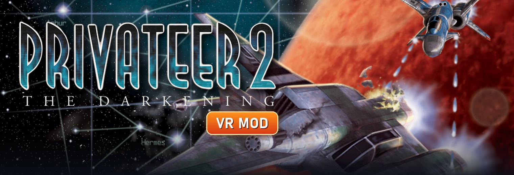
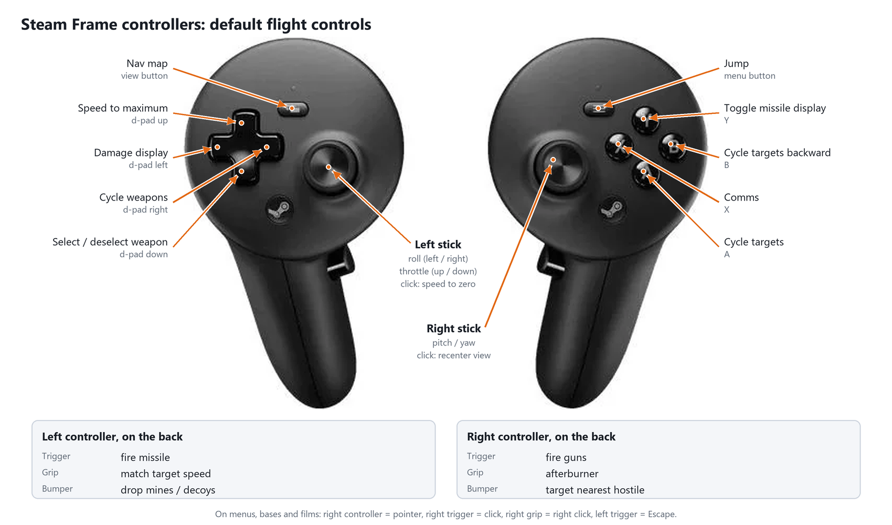
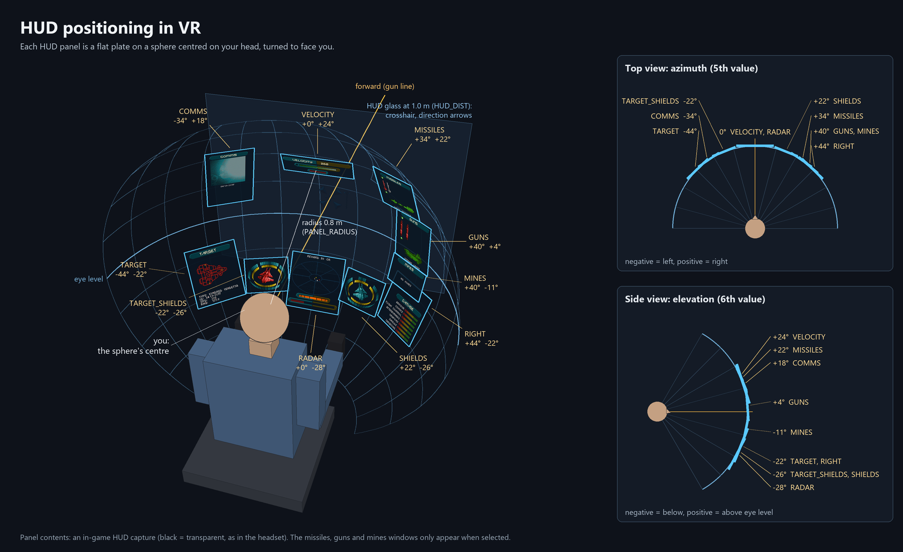

# Privateer 2 VR



**Privateer 2 VR** is a fan-made mod that lets you play **Privateer 2: The Darkening** (Origin Systems, 1996) in virtual reality. It runs through SteamVR/OpenXR. It was developed on the Steam Frame and should work with any SteamVR headset.

## The objective

Privateer 2 is a classic space trading and combat sim with full-motion-video storytelling. The goal of this project is to put you *in the cockpit*: real stereo 3D space flight, with your head tracked. The game's menus, bases and films stay intact. Nothing is re-made: the mod drives the game's own engine, so the ships, missions, story and balance are the original ones.

What it does:
- **True stereo 3D in space.** The game's own BRender engine renders the space scene once per eye, at the headset's resolution, from your tracked head position. Stars, space dust and lens flares are drawn per eye at the right depth.
- **A cockpit HUD around you.** The HUD is split into panels on a sphere around your head, each angled towards you: radar, shields, target display, comms, missiles and velocity. Their placement is configurable.
- **Markers in 3D.** The crosshair sits on the ship's gun line. Target brackets and the missile-lock reticle are attached to the target at its real distance. Direction arrows stay on the HUD glass.
- **Fly with the VR controllers**, or a joystick / HOTAS configured with the game's own tool. You get controller rumble when firing or hit.
- **Menus, bases, the PAD and the FMV films** play on a large virtual screen. You point and click with the controller.
- **Launcher and installer:** one click to install or update, and to start the game in VR or flat.

No game files are included: you need your own copy of the game.

## What you need

- **Privateer 2: The Darkening: 30th Anniversary Edition on Steam:**
  <https://store.steampowered.com/app/3067130/Privateer_2_The_Darkening_30th_Anniversary_Edition/>

  This is **the only version tested and the recommended one**:
  - It comes with **enhanced FMV** for the game's many films.
  - It includes the modern Windows enhancement layer (`p2den.dll`) that the mod builds on.

  Other editions (the original CD release, GOG) do not have that layer and are not supported. The installer tells you if the folder it finds is not this edition.
- **Windows 10 or 11** (64-bit) and a PC that runs SteamVR.
- **SteamVR** and a PC VR headset with two motion controllers. The mod was developed on the Steam Frame; Valve Index, Meta Quest (Link / Steam Link) and other SteamVR headsets should work.
- *Optional:* a joystick or HOTAS.

## Install

1. Download **[P2VR-Installer.exe](https://github.com/SPD13/privateer2-vr/releases/latest/download/P2VR-Installer.exe)** from the [latest release](https://github.com/SPD13/privateer2-vr/releases/latest) and run it.
   - The installer is not signed, so Windows SmartScreen may warn on first launch. Click *More info* > *Run anyway*.
2. The installer finds the game in your Steam libraries, or you choose its folder with **Browse…**.
   - It shows whether the mod is already installed and in which version, and checks GitHub for the latest release.
3. Press **Install** (or **Update** when a new version is out).
   - It adds these files next to the game's `DARK.EXE`:
     - `DARKVR.EXE`, made on your PC from your own `DARK.EXE`
     - `P2VR.dll` and `openxr_loader.dll`
     - `p2vr.ini` (the settings)
     - `P2VR-Launcher.exe`
   - It also adds a **Privateer 2 VR** shortcut to the desktop and the Start menu.
   - **No file of the game is changed.** Starting the game from Steam still plays it flat, as before.
   - On update, your `p2vr.ini` is kept; settings that are new in that version are added with their defaults.

## Play

Open the **Privateer 2 VR** shortcut. It starts the launcher:

- **Play in VR** starts SteamVR if it is not running yet, then the game in the headset.
- **Play flat** starts the original game on the monitor.
- The launcher also checks for updates. From it you can update, repair the mod (for example after Steam updated the game), or uninstall it, with or without your settings.

In VR:
- Menus, bases and films appear on a large screen in front of you.
- When you launch into space, the headset shows *"Entering Space in VR. Press the fire button to continue"*, so you can get ready before the flight starts.
- **Recenter** the view at any time with a right thumbstick click, or Ctrl+F12 on the keyboard.

## Controls

### VR controllers

The sticks fly the ship; buttons press the game's own keys. The default flight controls on the Steam Frame controllers:



All default bindings, for every controller type:

| Control | Index / Quest (Touch) | Steam Frame |
|---|---|---|
| Pitch / yaw | Right stick | Right stick |
| Roll (left/right), throttle (up/down) | Left stick | Left stick |
| Speed to zero | Left stick click | Left stick click |
| Recenter view | Right stick click | Right stick click |
| **Fire guns** | Right trigger | Right trigger |
| **Fire missile** | Left trigger | Left trigger |
| Afterburner | Right grip | Right grip |
| Match target speed | Left grip | Left grip |
| Cycle targets | A (right) | A (right) |
| Cycle targets backward | — | B (right) |
| Target nearest hostile | B (right) | Right bumper |
| Cycle weapons | A (left) / X (Touch) | Left d-pad right |
| Select / deselect weapon | — | Left d-pad down |
| Jump | B (left) / Y (Touch) | Right menu button |
| Speed to maximum | — | Left d-pad up |
| Drop mines / decoys | — | Left bumper |
| Toggle missile display | — | Y (right) |
| Comms | — | X (right) |
| Damage display | — | Left d-pad left |
| Nav map | — | Left view button |

On the menu, base, PAD and film screens:

| Control | Action |
|---|---|
| Right controller | Laser pointer: moves the mouse |
| Right trigger | Left click |
| Right grip | Right click |
| Left trigger | Escape (skip a film, leave a screen) |

**Changing the bindings:**
- **In SteamVR:** open *SteamVR > Settings > Controllers > Manage Controller Bindings*, pick *Privateer 2 VR*. Every game command is listed as an action you can bind: about 45 in all, including all views, radar modes, tractor beam, SOS, nav map, diary and options. Commands without a default binding can be added there.
- **In `p2vr.ini`:** change the key a command presses with `KEY_<COMMAND>=<scancode>`, or tune the sticks: deadzone, inversion, roll gain, throttle rate. See [SETTINGS.md](SETTINGS.md#vr-controllers).

### Joystick or HOTAS

The game's enhancement layer has its own joystick configuration tool, and the mod works with it:

1. Plug in the joystick and start the game (VR or flat).
2. In the game's **Options**, set the control method to **Joystick** (or **Joystick + throttle** for a throttle axis): your Alt+J mapping applies only in that mode.
3. Press **Alt+J** in the game to open the joystick tool.
   - It opens **on the desktop monitor**, not in the headset.
   - Meanwhile the headset shows *"Use the desktop to configure the joystick"*.
   - Map the axes (pitch, yaw, roll, throttle) and buttons (fire guns, missiles, targeting…) there, then close the tool. The mapping is saved per device in the game's `controllers` folder.
4. Fly with the joystick. With `JOYSTICK_PASSTHROUGH=1` (the default), the VR controllers keep working alongside it. Each axis is taken from a VR thumbstick only while that stick is deflected, so both can be used together.

The joystick button you map to *fire guns* also continues past the *Entering Space* prompt.

### Keyboard

The game's own keyboard controls all work. The mod adds:

| Keys | Action |
|---|---|
| Ctrl+F12 | Recenter the view |
| Ctrl+F2 / Ctrl+F3 | Record / replay an input macro (testing) |
| Ctrl+F9 | Save a capture for a bug report, see [Reporting a bug](#reporting-a-bug) |
| Ctrl+1 … Ctrl+8 | Cheats, see [Cheats](#cheats) |

## Cheats

The mod adds eight cheats. They work in flight; **Get cash** and **Fast forward** also work on the ground (bases, menus, the PAD). Each one shows a red confirmation message for a few seconds, on the monitor and in the headset.

| Cheat | What it does | Keyboard |
|---|---|---|
| **Restore shield and armor** | Shields and armour of all four sides of your ship back to full, and the hull armour condition (the *Armour* bar of the damage window) back to 100 %. | Ctrl+1 |
| **Destroy target** | The ship you have targeted explodes. It counts as your kill, with the usual bounty. | Ctrl+2 |
| **Destroy all enemies** | Every hostile ship in your area explodes, and any ship that is targeting you. Friendly and neutral ships are left alone. | Ctrl+3 |
| **Get cash** | +100,000 credits, shown with the game's own credit message. | Ctrl+4 |
| **Invincible** | Your ship takes no damage. Press again to turn it off. | Ctrl+5 |
| **Jump straight to destination** | Your next jump takes you directly to the destination you picked on the nav map, instead of the next waypoint of the route. Your wingmen follow. | Ctrl+6 |
| **Land now** | In an area with a station, base or planet you can land on, you land there at once: no approach, no landing request over comms. | Ctrl+7 |
| **Fast forward** | The whole game runs twice as fast: flying, combat, the game clock. Press again to come back to normal speed. It stays on, in flight and on the ground, until you switch it off. | Ctrl+8 |

Ships the game itself treats as indestructible are not affected by the destroy cheats.

### Using them

- **Keyboard:** press **Ctrl+1** to **Ctrl+8** in flight. The mod catches these keys while the game window is in front, so the game itself does not react to them.
- **VR controllers:** each cheat is a SteamVR action, with no button assigned by default:
  1. Start the game in VR.
  2. Open *SteamVR > Settings > Controllers > Manage Controller Bindings* and choose **Privateer 2 VR**.
  3. Edit the current binding, and assign a button to any of these actions:
     - `[CHEAT] Restore shield and armor`
     - `[CHEAT] Destroy target`
     - `[CHEAT] Destroy all enemies`
     - `[CHEAT] Get cash (+100,000 credits)`
     - `[CHEAT] Invincible (toggle)`
     - `[CHEAT] Jump straight to destination`
     - `[CHEAT] Land now`
     - `[CHEAT] Fast forward 2x (toggle)`
- **Joystick or HOTAS:** the game's Alt+J joystick tool can't list extra commands, so joystick buttons for the cheats are set in `p2vr.ini`:
  1. **Find the button's number.** Press **Win+R**, type `joy.cpl` and press Enter. Select your joystick and click **Properties**. Press the button you want to use: the number that lights up is the one to use.
  2. **Open `p2vr.ini`** in the game folder, with any text editor. The launcher's **Open game folder** button opens that folder; it is the Steam game's `Windows` folder, e.g. `…\steamapps\common\Privateer 2 The Darkening\Windows`.
  3. **Set the button for each cheat you want** in the `[VR]` section. The lines are already there, set to `0` (no button):
     ```ini
     CHEAT_RESTORE_BUTTON=0          ; restore shield and armor
     CHEAT_DESTROY_TARGET_BUTTON=0   ; destroy target
     CHEAT_DESTROY_ENEMIES_BUTTON=0  ; destroy all enemies
     CHEAT_CASH_BUTTON=0             ; +100,000 credits (also on the ground)
     CHEAT_INVINCIBLE_BUTTON=0       ; invincible on/off
     CHEAT_JUMP_BUTTON=0             ; next jump straight to the destination
     CHEAT_LAND_BUTTON=0             ; land now
     CHEAT_SPEED_BUTTON=0            ; fast forward 2x on/off (also on the ground)
     ```
     For example, `CHEAT_SPEED_BUTTON=12` makes button 12 toggle fast forward.
  4. **In the Alt+J tool**, set those buttons to *None*, so they don't also trigger a game command.
  5. **Restart the game**: `p2vr.ini` is only read at startup.

  Only buttons **1 to 32** can be used for cheats, because Windows reports at most 32 buttons per joystick to the mod. If several joysticks are connected, the button with that number on any of them triggers the cheat.

### Turning cheats off

Set `CHEATS=0` in `p2vr.ini` to disable all of them: keys, VR actions and joystick buttons. All the settings are described in [SETTINGS.md](SETTINGS.md#cheats).

## Reporting a bug

If something doesn't work or looks wrong, a bug report with a capture of the problem helps us fix it quickly:

1. **Capture the problem in the game.** Press **Ctrl+F9** while the problem is on screen, in flight or on the ground (menus, bases, PAD). A red message confirms *"CAPTURE n SAVED FOR A BUG REPORT"*. Each capture saves:
   - both eye images, a preview and the HUD, in flight; the displayed screen, on the ground
   - the game state: phase, position, target, shields, active cheats…
   - your settings (`p2vr.ini`) and the mod's log at that moment

   You can make several captures; they are kept per session in the `p2vr-reports` folder of the game.
2. **Make the bug report zip.** Open the launcher (the **Privateer 2 VR** shortcut) and click **Report a bug** at the bottom. It lists the captures of your recent sessions with a preview and a summary. Pick the one showing the problem and click **Save bug report (.zip)**. The zip is saved in your **Downloads** folder, with the launcher's log and basic system information (Windows version, mod and launcher versions).
3. **Open a GitHub issue.** Click **Open a GitHub issue** in the same place (or go to [Issues](https://github.com/SPD13/privateer2-vr/issues) > *New issue* > *Bug report*). Describe what happened and how to make it happen, then drag the zip into the issue. GitHub accepts attachments up to 25 MB; if the zip is bigger, share it with a file sharing service and paste the link.

The zip contains no personal files: only the captured images, the mod's logs and settings, and the system information listed above.

## HUD Positioning



In the flat game the HUD is drawn over the whole screen. In VR, the corners of that screen would end up at the edges of your view, where they are hard to read. So the mod cuts the HUD into **panels** and places them like cockpit instruments, on an imaginary **sphere centred on your head**:

- **Radius:** every panel is **0.8 m** from your eyes (`PANEL_RADIUS`). That is a comfortable reading distance, and the same for all panels, so your eyes never refocus when they move from one panel to the next.
- **Azimuth (left / right):** the angle from straight ahead, seen from above. Negative is to the left, positive to the right: the comms window is at −34°, the guns window at +40°.
- **Elevation (up / down):** the angle from eye level, seen from the side. Positive is above, negative below: the velocity readout is at +24°, the radar at −28°.
- **Curvature:** each panel is a flat plate turned to **face your head**. Together they follow the curve of the sphere, so every panel is seen straight on, never at a slant, wherever it is.
- **What stays in front:** whatever is not in a panel stays on the **HUD glass**, a flat plane 1 m ahead (`HUD_DIST`). That's the crosshair, the direction arrows and the messages. Target brackets and the missile lock are not on the glass: they are attached to the target in 3D, at its real distance.

The panels sit around the edges of your view, below and above the gun line. That leaves the centre clear for flying and fighting: a glance, or a small turn of the head, is enough to read them.

Each panel is one line in `p2vr.ini`:

```ini
PANEL_RADAR=254,338,388,478, 0,-28, 0.30
;           x0, y0, x1, y1   az, el  width (m) [, radius (m)]
```

The first four numbers are the rectangle cut from the game's 640×480 HUD. Then come the azimuth and elevation in degrees, and the panel's width in metres; its height follows the rectangle's shape. An optional last number gives that panel its own distance. `PANEL_<NAME>=0` removes a panel, and `HUD_PANELS=0` goes back to one flat HUD. Every panel and its default is listed in [SETTINGS.md](SETTINGS.md#hud-panels).

## Settings (`p2vr.ini`)

All options of the mod are in **`p2vr.ini`**, in the game folder (the launcher's *Open game folder* button opens it). Edit it with any text editor while the game is closed. Main groups:

- **VR presentation:** world scale (how big space feels), resolution per eye, frame smoothing, the *Entering Space* prompt.
- **HUD and markers:** HUD distance and transparency, crosshair placement and opacity, the yellow target arrow.
- **HUD panels:** turn the panel layout on or off, and place each panel by angle, height, size and distance.
- **Space visuals:** star size, space dust, lens flare, shot spread.
- **Menus and films:** size and distance of the virtual screen.
- **VR controllers and joystick:** deadzone, inversion, gains, joystick pass-through, keys sent by each command.
- **Rumble:** on/off and strength for shots and hits.

Every setting, its default and its effect is explained in **[SETTINGS.md](SETTINGS.md)**; the installer also places it in the game folder as `P2VR-SETTINGS.md`. The defaults are always available in `p2vr.default.ini`.

## Uninstall

Open the launcher (or the installer) and choose **Uninstall the VR mod…**. It removes the mod's files and shortcuts; tick *Also remove my VR settings* to delete `p2vr.ini` too. The game itself is untouched.

## Troubleshooting

- **The installer does not find the game:** press **Browse…** and choose the game's folder: `…\steamapps\common\Privateer 2 The Darkening`.
- **"Needs repair":** Steam updated the game. Press **Repair** in the launcher.
- **Windows does not allow writing to the game folder:** use the *Restart the installer as administrator* button.
- **The headset stays black, or the game starts flat:** check that SteamVR is running with the headset connected, then use **Play in VR**.
- Logs:
  - `p2vr.log` in the game folder: the mod.
  - `%LOCALAPPDATA%\p2vr-installer\installer.log`: the installer and launcher.

  Please report bugs as described in [Reporting a bug](#reporting-a-bug).

---

## For developers

### How it hooks in
- **The executable:** `DARKVR.EXE` is a copy of `DARK.EXE` whose import `P2DEN.dll` is renamed to `P2VR.dll` (`scripts/make_darkvr.py`, or the installer).
- **The enhancement layer:** `P2VR.dll` re-exports `DirectDrawCreate` from the edition's enhancement layer (`p2den.dll`), which keeps working unchanged.
- **The engine:** the game's Argonaut BRender engine is statically linked into `DARK.EXE`. `P2VR.dll` uses it in three ways:
  - It detours BRender scene rendering, the starfield, the HUD and its markers (`src/p2vr.cpp`).
  - It captures p2den's D3D11 output and palette, and composites the monitor view (`src/capture.cpp`).
  - It runs an OpenXR presenter on its own thread, with its own D3D11 device (`src/vr.cpp`).
- **What it changes for VR:**
  - Each eye is rendered at SteamVR's recommended size. BRender's 2048 px limit is lifted, and each eye's frustum is centred on its own field of view.
  - Frames are smoothed between the game's ~30 Hz steps.

### Build
These steps assume Windows and Visual Studio 2022 or newer, with the x86 toolset.
1. Download the OpenXR SDK loader release `openxr_loader_windows-1.1.x` and extract it to `ref/openxr/`, so that `ref/openxr/include` and `ref/openxr/Win32` exist.
2. Run `src\build.bat`. The output is `build\p2vr.dll` and `build\openxr_loader.dll`. Set `P2VR_VERSION=x.y.z` first for a versioned build.
3. The installer and launcher (`installer/`, Go + WebView2) builds with `installer\build.ps1`; see [RELEASING.md](RELEASING.md).

### Manual install into a working copy
1. Copy the contents of `<Steam>\steamapps\common\Privateer 2 The Darkening\Windows` to a working folder (e.g. `game\`). You can link the large FMV folders with directory junctions instead of copying them.
2. Run `python scripts/make_darkvr.py game/DARK.EXE game/DARKVR.EXE`.
3. Copy `build\p2vr.dll` (as `P2VR.dll`), `build\openxr_loader.dll` and `dist\p2vr.ini` into the folder.
4. Start SteamVR, then run `DARKVR.EXE`.

### Releases
Pushing a tag `vX.Y.Z` builds and publishes a release: the mod archive `privateer2-vr-X.Y.Z.zip` and `P2VR-Installer.exe`. See [RELEASING.md](RELEASING.md).

### Docs
- [SETTINGS.md](SETTINGS.md): every `p2vr.ini` setting.
- [RELEASING.md](RELEASING.md): versioning, release workflow, local builds.
- `SPIKE_REPORT.md`: the feasibility spike and its go/no-go result.
- `notes/RE_NOTES.md`: addresses, structures and algorithms found by reverse engineering.
- `notes/SESSION_NOTES.md`: development notes from the cheats / bug report / transition work: game data, D3D11 and p2den behaviour, the flight-or-flat logic, pitfalls and working practices.
- `docs/hud-positioning.png`: the HUD positioning diagram, drawn by `scripts/make_hud_diagram.py` from the default panel layout and an in-game HUD capture (`docs/hud-capture.png`). Run it again after changing the panel defaults.
- `docs/steam-frame-controls.png`: the Steam Frame controller bindings, drawn by `scripts/make_controller_diagram.py` from a photo of the controllers. Run it again after changing the Frame defaults in `src/commands.h`.

## Credits and legal

- **Privateer 2: The Darkening** © Electronic Arts / Origin Systems. This mod is a fan project, not affiliated with or endorsed by them. You need your own copy of the game; no game files are distributed. The installer artwork uses the game's own art.
- **The enhancement layer** (`p2den.dll`) is part of the 30th Anniversary Edition.
- The OpenXR loader is © The Khronos Group (Apache 2.0).
